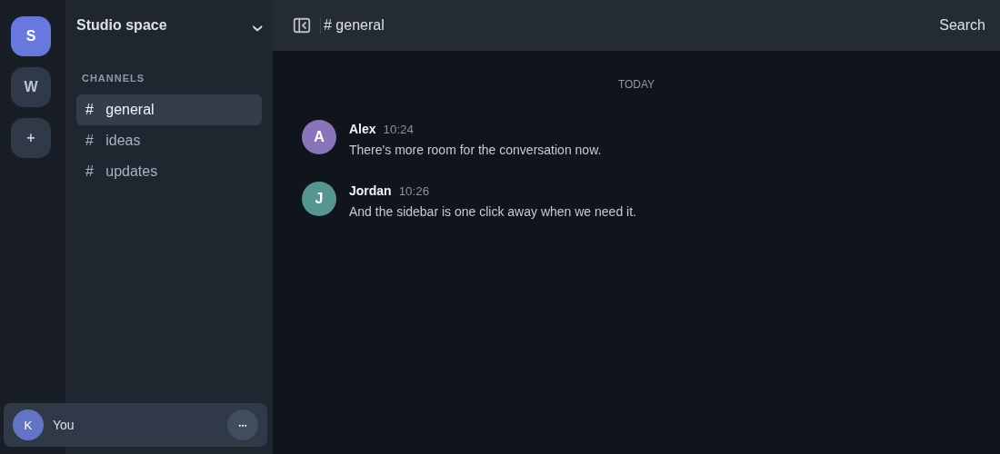
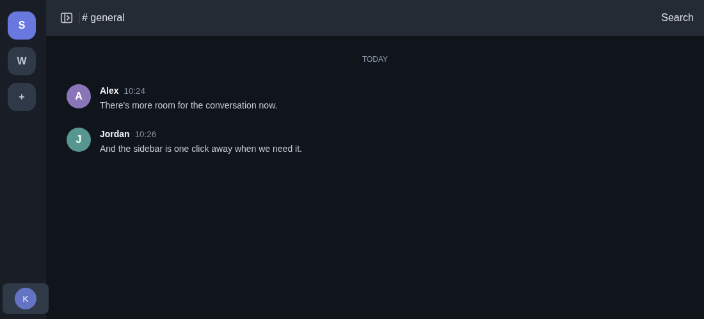

# Sidebar Toggle

A small Vencord user plugin that gives your conversations more room. Click the button at the start of the page header to collapse the channel or DM sidebar; click it again to bring it back.




*Illustrations generated with the plugin in a mock Discord layout. Your client keeps its own theme.*

## Features

- A header button that follows the existing page layout and colors, including on Discover, Nitro, and Shop.
- A directional icon, Discord tooltip, keyboard focus, and an accessible label that changes with the sidebar state.
- The server rail remains visible. Hover or focus the account panel to expand its controls while the sidebar is collapsed.
- If a page has no supported header, the plugin reopens the sidebar so it does not leave you stuck. Disabling the plugin also restores it.

## Installation

This is a **source user plugin**, not a theme or a plugin in the official Vencord list. It must be included in a custom Vencord build. You need Git, Node.js, and pnpm; see the [Vencord build guide](https://docs.vencord.dev/installing/) for prerequisites and platform-specific details.

If you already have a Vencord source checkout, keep your existing `src/userplugins` and copy `src/sidebarToggle` from this repository into it. Otherwise, a fresh setup looks like this in a shell:

```sh
git clone https://github.com/Kevin-Ebrahim/vencord-sidebar-toggle.git
git clone https://github.com/Vendicated/Vencord.git
cd Vencord
pnpm install --frozen-lockfile
mkdir -p src/userplugins
cp -R ../vencord-sidebar-toggle/src/sidebarToggle src/userplugins/
pnpm build
```

Point your client at the resulting Vencord build:

- **Vesktop:** open **Settings → Vesktop → Open Developer Settings**, choose **Change** under **Vencord Location**, and select the Vencord `dist` folder. Fully quit Vesktop, including the tray icon, and reopen it. Flatpak users may need to grant access to the build directory; the [Vencord guide](https://docs.vencord.dev/installing/) has details.
- **Discord desktop:** run `pnpm inject` from the Vencord checkout and follow the installer.

Then enable **SidebarToggle** under **Settings → Vencord → Plugins** and reload when prompted. Updates to this plugin require copying the new source, rebuilding Vencord, and restarting the client.

## Compatibility

Tested on Linux with Vesktop 1.6.9 and Vencord commit [`383409e`](https://github.com/Vendicated/Vencord/commit/383409e6a6ec9008ee8a7496500f1e75f17824d1). Discord can change its internal layout and break custom plugins, so other versions and clients may need adjustments. The plugin does not make network requests or collect data.

## Development

The browser tests run the actual plugin in a mock layout; they do not replace testing against Discord itself. With Node.js 24 and Chromium installed:

```sh
npm ci
CHROME_PATH=/path/to/chromium npm test
```

`CHROME_PATH` defaults to `/usr/bin/chromium`. The tests cover layout spacing, collapse and restore, account controls, colored headers, page changes, recovery, and disabling the plugin.

## Credits and license

Created by [Kevin-Ebrahim](https://github.com/Kevin-Ebrahim). Built for [Vencord](https://github.com/Vendicated/Vencord), with thanks to its contributors.

Licensed under [GPL-3.0-or-later](LICENSE). This is an independent project and is not affiliated with Discord or Vencord.
